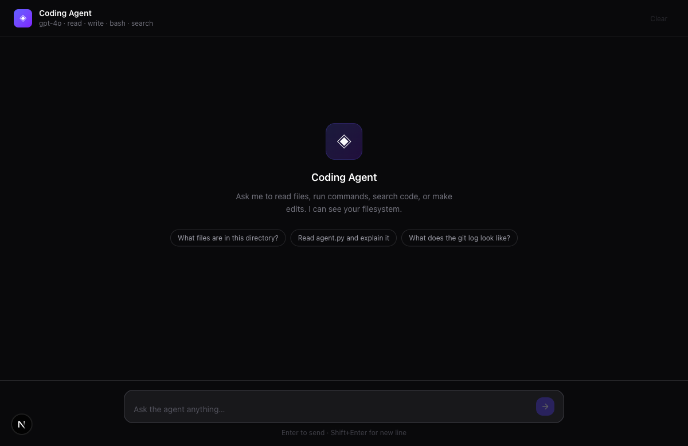
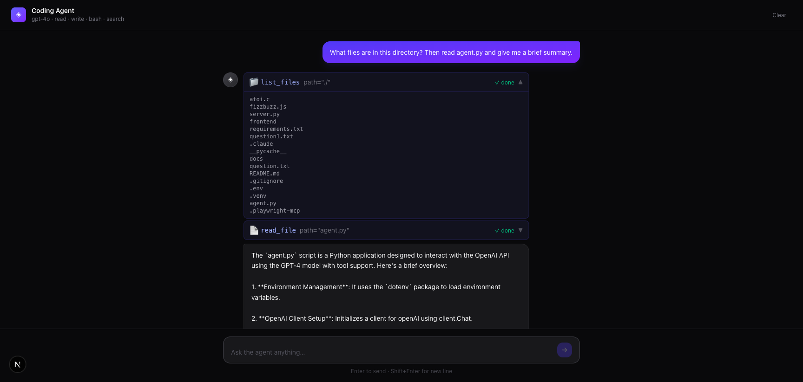

# Coding Agent

A coding agent built from scratch — CLI and web interface. Uses the OpenAI API with a manual agentic loop: the model decides which tools to call, you execute them, feed the results back, and repeat until it's done.

## Screenshots

### Empty state


### Agent using tools
The agent lists files, reads `agent.py`, and summarizes it — all in one turn.



## Architecture

```
coding-agent/
├── agent.py      # CLI version
├── server.py     # FastAPI backend (SSE streaming)
└── frontend/     # Next.js 16 + TypeScript + Tailwind
```

**The agentic loop** (both CLI and server):
1. Send user message + conversation history to the model
2. If `finish_reason == "tool_calls"` → execute the tools, append results, go to 1
3. If `finish_reason == "stop"` → print/stream the reply, wait for next user message

The API is stateless — the entire conversation history is sent on every request. The `conversation` list is the agent's memory.

## Tools

| Tool | Description |
|------|-------------|
| `read_file` | Read a file's contents |
| `list_files` | List files in a directory |
| `bash` | Execute any shell command |
| `edit_file` | Write/overwrite a file |
| `search_code` | Search for patterns with ripgrep |

## Setup

**1. Install Python dependencies**
```bash
python -m venv .venv
source .venv/bin/activate
pip install -r requirements.txt
```

**2. Set your OpenAI API key**
```bash
echo "OPENAI_API_KEY=sk-..." > .env
```

**3. Install ripgrep** (for `search_code`)
```bash
brew install ripgrep
```

## Running

### CLI
```bash
source .venv/bin/activate
python agent.py
```

### Web interface

**Backend** (port 8000):
```bash
source .venv/bin/activate
uvicorn server:app --port 8000 --reload
```

**Frontend** (port 3000):
```bash
cd frontend
npm install
npm run dev
```

Open [http://localhost:3000](http://localhost:3000).

## Frontend

- **Next.js 16** with App Router
- **TypeScript** + **Tailwind CSS**
- Streaming text rendered token-by-token via SSE
- Tool calls shown inline with expandable results
- Suggestion chips on empty state
- Clear conversation button
